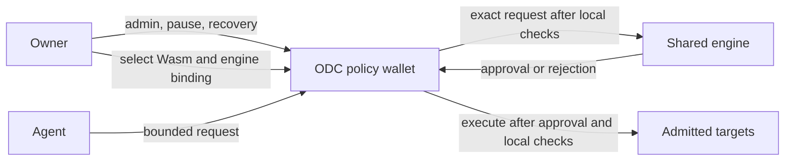
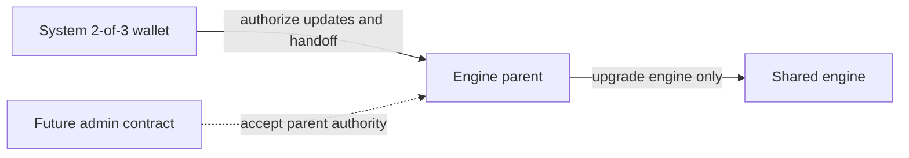

# ODC and shared-engine architecture

The ODC (policy wallet) holds assets and enforces the owner's delegation locally. The shared engine can refuse an agent operation. It cannot enlarge that delegation, administer the wallet or replace its code.

The [README](../README.md) defines the transfer-only MVP and the separate legacy daily-limit vault. [Administration](admin.md) covers setup and owner operations.

## Custody and owner control

The owner controls ODC code upgrades, policy configuration, agent delegation and engine binding. Owner administration, pause and recovery use independent entrypoints that never call the engine. Engine failure, denial or upgrade cannot block those paths. An ODC authority change invalidates stale agent requests through a configuration epoch change. Owner handoff requires current-owner authorization and candidate acceptance, preserving accounting. The owner address must be owner-only: no agent or engine signer may reach its medium threshold.

Store a direct owner-selected Wasm hash in each ODC executable. Many ODC instances can share the same small kernel Wasm while retaining separate state. Compiled Rust implements the kernel and its owner-approved deterministic policy checks. Source need not be duplicated per wallet. Owner dispatch and envelope checks remain in owner-trusted code, outside the system-upgradeable engine. No policy interpreter belongs in this custody boundary. Stellar stores [contract code separately from instance state](https://developers.stellar.org/docs/learn/fundamentals/contract-development/overview), so identical Wasm need not be uploaded for each wallet.

[CAP-0085 executable references](https://github.com/stellar/stellar-protocol/blob/master/core/cap-0085.md) permit fleet upgrades through a separately managed executable entry. A system-controlled reference for ODC code would let the system replace custody checks. Do not use that configuration. An owner-controlled reference is optional, with the same owner trust boundary. An owner-controlled helper or proxy adds footprint and offers no per-instance code saving over shared Wasm. Shared code still requires TTL maintenance. Per-wallet state still has [storage and restoration costs](https://developers.stellar.org/docs/learn/fundamentals/contract-development/storage/persisting-data).

## Engine upgrades

The shared engine has a parent contract administered by a 2-of-3 wallet. A future administrator contract replaces that authority address on the unchanged parent. The current authority authorizes the handoff. The candidate accepts the exact parent, network and revision. The handoff preserves state. The parent controls engine upgrades only, with no ODC upgrade, recovery or configuration authority.

## Execution and local containment

The local kernel must enforce:

- Owner identity, authorized agent, request nonce, configuration epoch and expiry. Owner signatures govern configuration. Agent signatures govern delegated requests.
- An owner-approved operation allowlist and envelope: target, method, exact arguments, assets, recipient, amount, hard spending caps and count limits.
- Persistent local spending and count state. Funding, configuration changes and engine replacement cannot erase consumed limits or replay history.
- Exact authorization subtrees for admitted calls. Authorize no ambient spending authority. Stellar's [authorization framework](https://developers.stellar.org/docs/learn/fundamentals/contract-development/authorization) binds required authorization to invocation contexts.

General contract calls default to disabled. Enable only owner-allowlisted operations with locally bounded effects. Policy configuration constrains permitted arguments. Each execution binds exact arguments within those constraints. The baseline rejects token approvals, persistent allowances and uncontrolled token pulls.

The ODC constructs the request from authenticated arguments and its own state. Engine approval binds that request and configuration. The engine returns an approval boolean, not commands, accounting deltas or expanded local policy. Missing approval, malformed responses, engine traps, archival and resource exhaustion reject agent execution. The ODC exposes no external `__check_auth` hook. Raw agent-signed token or dApp authorization rejects. The engine receives no ODC spending authorization.

The ODC authorizes an exact direct SAC transfer, checks sender debits and recipient credits, and updates its counters atomically. Incoming funds cannot conceal outgoing spending through a net balance comparison. Reject effects that the local kernel cannot verify. A failed call or effect mismatch reverts accounting and execution.

A compromised engine can approve every request that already fits the local delegation. It can therefore consume all delegated capacity. It cannot prove compliance with an arbitrary owner-authored predicate that only the engine evaluates. Enforce every restriction that must survive engine compromise inside the owner-controlled ODC kernel. Otherwise, explicitly accept engine trust for that restriction. Owner-kernel bug fixes require owner upgrades. Shared engine fixes can take effect immediately, but cannot repair kernel bugs. Engine approval never substitutes for local containment.

Issuer clawback or freeze, malicious admitted tokens or targets, owner-key compromise, fees, network availability and TTL restoration remain separate risks.
