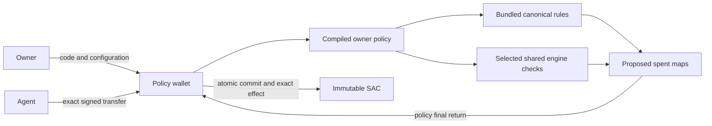

# Policy wallet and rule execution

The owner selects custody code, agent, immutable SAC and authored policy. The kernel protects
custody mechanics. The policy selects business rules and the final usage data to commit.



## Configuration and functional state

`Grant` is a map of names to exact native values. It is immutable during delegated execution. The
kernel requires no daily limit, recipient list or other optional rule parameter. Each selected rule
validates its own needed keys. Top-level names are native Strings with valid UTF-8. Unrelated
values are preserved without coercion, with no policy-imposed count or value-type limit.

`Spent` is a separate persistent raw map under the stable policy instance. It supports arbitrary
named data, including keys selected by the engine. Scalar helpers read or transform u64, Boolean
and String entries. They reject a requested entry of the wrong type and preserve unrelated values.

The authored entrypoint receives the request, Grant and full state view. Rule calls return Spent
values. `with_spent` replaces the view's spent map while preserving its Grant:

```rust
let daily = allowit::daily_cap(request, state)?;
let after_daily = allowit::with_spent(state, daily)?;
let total = engine::total_cap(request, &after_daily)?;
let n = allowit::state_get(&total, "custom_count", 0u64)?;
let final_spent = allowit::state_set(total, "custom_count", n + 1)?;
Ok(final_spent)
```

Only the final returned map commits. Helpers have no hidden persistent writes or merge behavior.
Returning an earlier map deliberately discards later unused results. A property-only policy starts
with `spent(state)`. An unchanged map avoids a data write, and an unused empty map creates no entry.
Native persistent storage preserves archived data through restoration rather than treating it as
new data. `policy_spent()` reads the complete map. Owner control paths do not load it.

## Rule placement and responsibility

The SDK planner selects placement before deployment from enforcement responsibility, expected
volume and compatible supplied cost estimates. Its manifest records the choice and reason.
`self::` selects eligible bundled rules, `engine::` selects shared checks, and `allowit::` uses the
planner. Missing compatible costs use the documented responsibility default. System or external
authority requirements cannot be moved locally merely to reduce cost.

Both placements call the canonical `allowit-policy-rules` implementation. Bundled calls reference
selected functions directly. A missing, false or failed shared check follows the authored result
semantics and never triggers a local fallback. Genuine predicate APIs preserve ordinary false
separately from errors.

Each shared call receives copied request data and the full Grant/Spent view. It returns only
`EngineResult { approval, spent }`. It cannot mutate caller references or return executable
commands. The canonical daily, total and call rules record the logical operation ID in their usage
map, so repeated checks revalidate bounds without charging the same operation twice. Their exact
keys, units, UTC rollover and errors are documented in `crates/rules/src/lib.rs`.

A selected shared engine is trusted for its decision and returned business-state integrity. It can
alter usage keys also read by bundled checks. Bundling one rule does not create per-key isolation
from other shared writers. The compiled policy determines which map becomes authoritative.

## Custody invariants and authorization

The kernel independently checks agent authority, installed policy/module/schema, canonical
arguments, immutable SAC and wallet source, positive amount, self-payment, pause, expiry,
`deployment_version`, execution nonce and operation replay. It imposes no hidden business counters
or automatic checks based on Grant key names. The `execute` path checks exact sender debit and
recipient credit. Native effects, final spent data, nonce and receipt commit atomically.

The x402 hook accepts one exact installed-SAC transfer context and the complete canonical request.
The owner explicitly selects `x402_enabled`; its key derives from the requested G-agent. A signed
owner deployment can atomically update the agent or Grant and retain enablement. It rebuilds the
agent/asset cache. Old requests fail the deployment version or derived-key checks. False disables
the path. Native account signer or threshold changes do not revoke this raw-key delegation.

The signature covers SHA-256 of XDR `(Symbol("allowit_x402_v1"), host_payload, execution)`. The host
payload binds network, native authorization nonce, ledger expiry and invocation tree. The hook
uses cached authenticated asset metadata and makes no active-SAC callback. Native SAC semantics
provide its effects guarantee. The engine receives no wallet token-authorization subtree.

## Owner control and releases

`deploy_policy` signs owner, agent, engine, Grant, x402 enablement and optional kernel hash at the
next `deployment_version`. A changed owner also authorizes the exact packet. Deployment preserves
pause and spent data. Only `set_pause(paused, deployment_version)` changes pause. Recovery requires
owner authorization, has no configuration-version fence and does not change delegated usage.
Keep owner authority independent of automated signers.

`contract_version` identifies the supported custody release/layout; `engine_version` identifies the
engine release. Both begin at 1. Exact Wasm hashes identify code. The engine parent orders its own
administration with a separate version and can replace shared engine code only. It cannot change
wallet code, Grant, authority or asset. Wallet code uses a direct owner-selected Wasm hash rather
than a system-controlled executable reference. Owner paths never query the engine.

Normal calls accept one known state format and never migrate it. For an incompatible state change:
pause, deploy and run a migration contract, deploy the new contract using the migrated state, then
unpause. Migration must preserve authoritative usage, ordering and replay history. Issuer controls,
TTL restoration and native network availability remain separate from engine authority.
